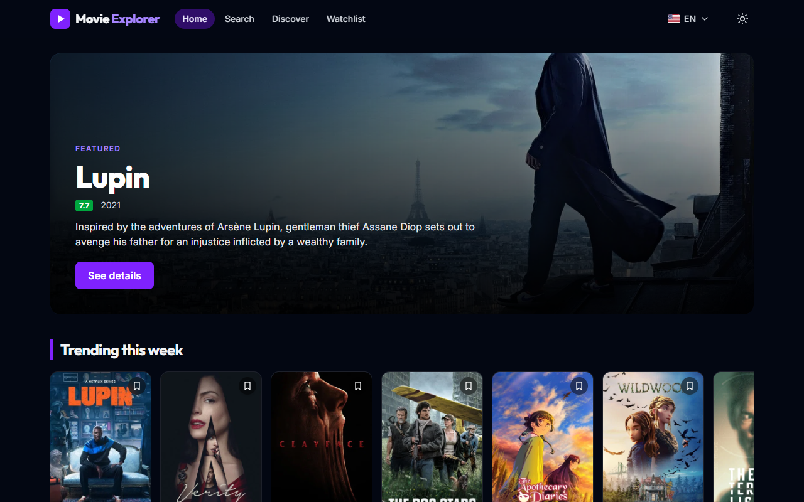
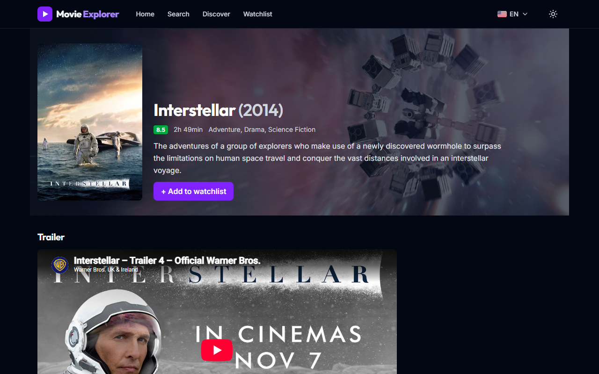
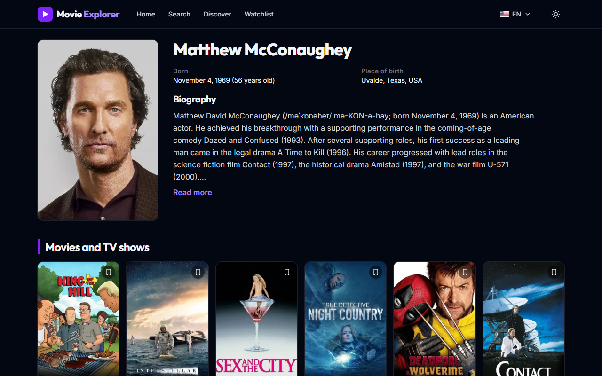
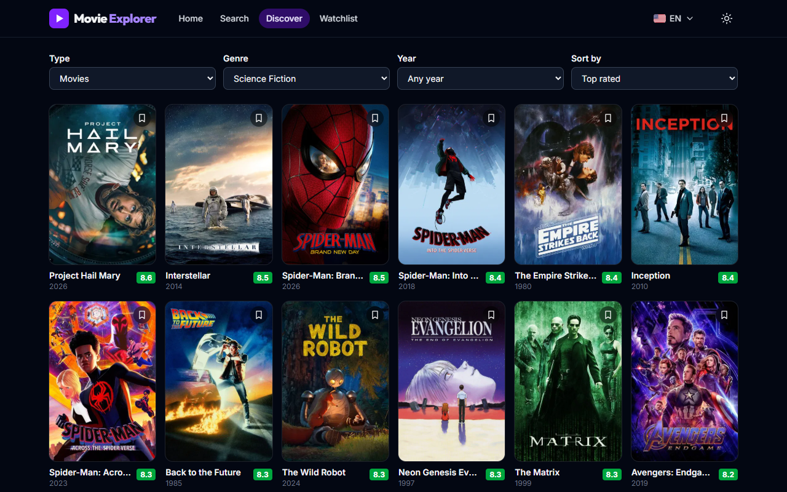
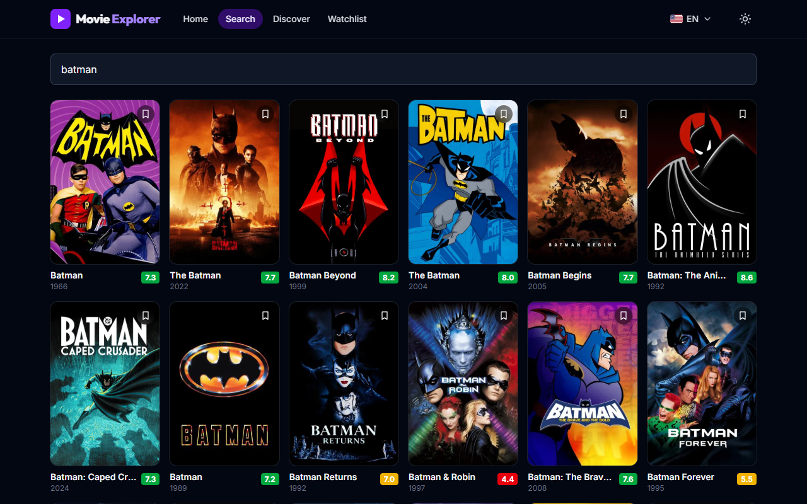
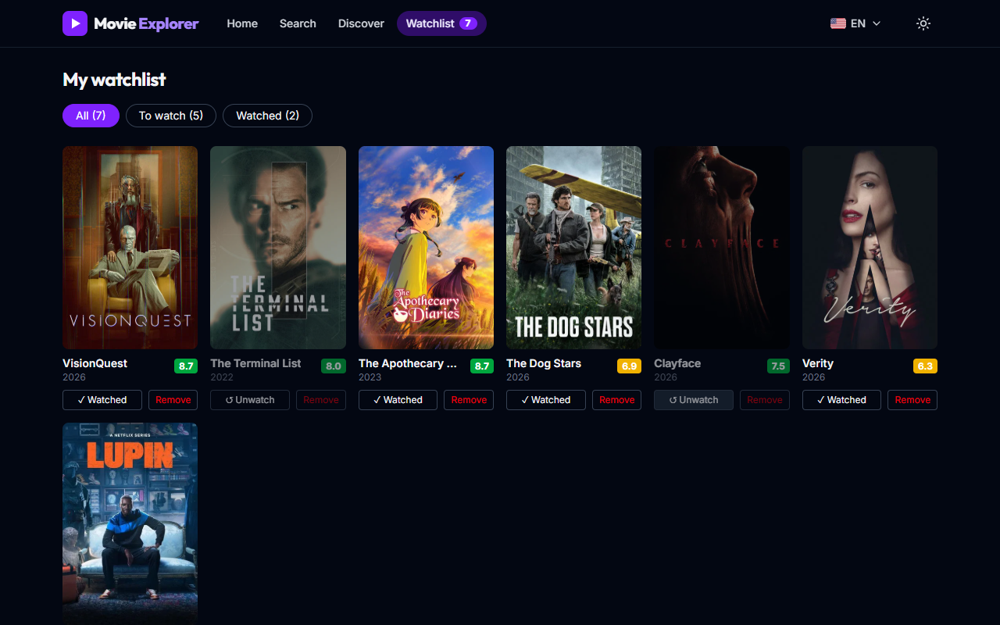
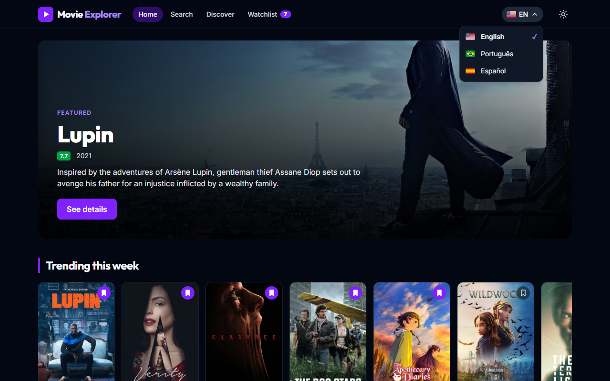
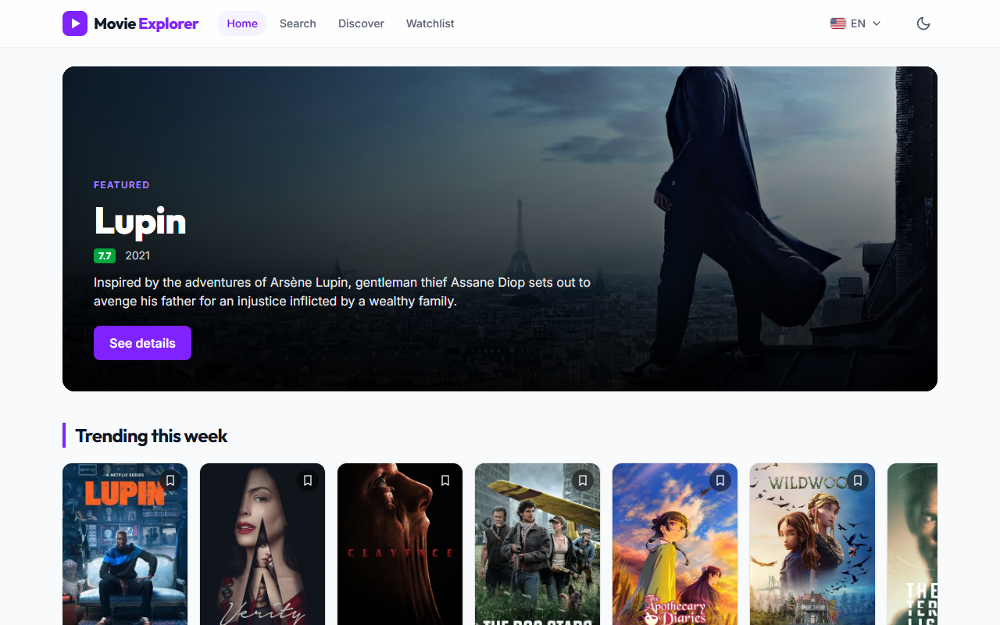
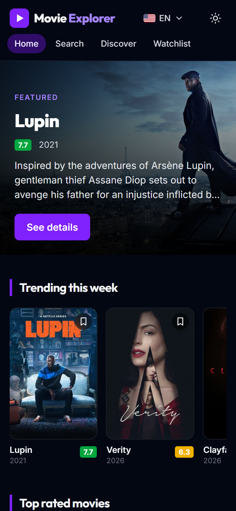

<div align="center">


# Movie Explorer

Um explorador de filmes e séries feito com Angular, signals e a API do TMDB.<br />
A movie and TV show explorer built with Angular, signals and the TMDB API.


<a href="#portugues"> <b>Português</b></a>
&nbsp;·&nbsp;
<a href="#english"> <b>English</b></a>

<br /><br />



</div>

---

<a id="portugues"></a>

##  Português

Busque filmes e séries, filtre por gênero e ano, veja os detalhes com trailer e elenco, explore a filmografia de um ator e monte a sua própria lista para assistir. Não tem back-end próprio: o app conversa direto com a [API do TMDB](https://www.themoviedb.org/documentation/api) e guarda a lista no navegador (`localStorage`).

### Screenshots

|                                               Detalhes                                                |                                       Página do ator                                       |
| :---------------------------------------------------------------------------------------------------: | :----------------------------------------------------------------------------------------: |
|                        |  |
|                                       **Explorar com filtros**                                        |                                         **Busca**                                          |
|    |                         |
|                                            **Minha lista**                                            |                                   **Seletor de idioma**                                    |
|  |        |

<p align="center">
  <b>Modo claro e celular</b><br />
  
  
</p>

### Tecnologias

| Item         | Tecnologia                                                                       |
| :----------- | :------------------------------------------------------------------------------- |
| Framework    | Angular 22: standalone components, signals, `rxResource`, rotas com lazy loading |
| Linguagem    | TypeScript (strict mode)                                                         |
| Estilo       | Tailwind CSS 4 com uma cor `brand` própria e dark mode por classe                |
| HTTP / async | `HttpClient`, RxJS, interceptors funcionais                                      |
| Dados        | [API do TMDB](https://www.themoviedb.org/documentation/api)                      |
| Testes       | Vitest + `TestBed` do Angular + `HttpTestingController`                          |
| Formatação   | Prettier                                                                         |

### Funcionalidades

- **Início** com um título em destaque (hero) e carrosséis: em alta, mais bem avaliados e em breve.
- **Busca** com debounce de 400 ms e scroll infinito. Requests antigos são cancelados enquanto você digita (`switchMap`).
- **Explorar** com filtros de tipo, gênero, ano e ordenação. Os filtros ficam na URL, então links e o botão voltar funcionam.
- **Detalhes** com pôster, sinopse, nota, duração, gêneros, trailer do YouTube, elenco e títulos semelhantes.
- **Página do ator** com idade, local de nascimento, biografia (usa a versão em inglês quando não há tradução) e filmografia sem duplicados nem participações em talk shows.
- **Minha lista** salva no `localStorage`: adicione por qualquer card, marque como assistido, filtre e remova. O header mostra um contador.
- **3 idiomas** (inglês, português e espanhol) com bandeiras. A escolha muda os textos da tela, os dados do TMDB e o título da aba.
- **Dark mode** que segue o sistema na primeira visita e lembra a sua escolha, sem "piscar" branco ao carregar.
- **Carregamento e erros**: skeletons enquanto carrega, estado vazio em todas as listas, toast de erro e página 404.
- **Responsivo**: 2 colunas no celular, até 6 no desktop.

### Como rodar

Você precisa do **Node.js 22.22+ ou 24.15+** e de um **API Read Access Token** gratuito do TMDB ([crie uma conta](https://www.themoviedb.org/signup) e vá em _Settings → API_).

```bash
git clone https://github.com/jihedberlim/movie-explorer.git
cd movie-explorer
npm ci
```

Copie `src/environments/environment.example.ts` para `src/environments/environment.ts` e cole o seu token em `tmdbToken`. O `environment.ts` de verdade está no `.gitignore`, então o token nunca vai para o GitHub.

```bash
npm start
```

Abra http://localhost:4200.

### Rodando os testes

```bash
npm test
```

São 151 testes unitários com Vitest. Eles cobrem as regras de negócio (nível da nota, filtros da URL, filmografia, idade, escolha do idioma), os services (URLs e parâmetros do TMDB, lista, tema, idioma), os interceptors e os principais componentes. As chamadas HTTP são simuladas com `HttpTestingController`, então os testes nunca chamam o TMDB de verdade.

### Estrutura do projeto

```
src/app/
  core/          # services, interceptors, models, i18n e regras de negócio puras (utils)
  shared/        # componentes reutilizáveis: movie-card, carrossel, rating-badge, skeleton, toast...
  features/      # uma pasta por página, cada uma com lazy loading: home, search, discover,
                 # details, person, watchlist, not-found
```

### O que eu aprendi

- **Signals e RxJS juntos**: os signals guardam o estado da tela (lista, tema, filtros) e o RxJS cuida dos fluxos no tempo, como o debounce da busca e o cancelamento de requests antigos.
- **A URL como fonte da verdade**: os filtros do Explorar são lidos da URL, então compartilhar um link ou apertar _voltar_ traz os mesmos resultados.
- **Interceptors**: um lugar adiciona o token, outro adiciona o idioma e outro mostra o toast de erro. As páginas não precisam saber de nada disso.
- **Condições de corrida**: quando um filtro muda enquanto a próxima página está carregando, a resposta antiga precisa ser ignorada. Senão ela se mistura com a lista nova.
- **Testes com dublês**: `HttpTestingController` e um `DOCUMENT` falso permitem testar requests e o recarregamento da página sem rede e sem recarregar de verdade.
- **Trade-offs**: trocar o idioma recarrega a página. É menos código do que fazer cada request reagir ao idioma, e ainda atualiza os dados que já tinham vindo do TMDB.

### Próximos passos

- [ ] Testes E2E com Playwright (com a API do TMDB mockada)
- [ ] Dockerfile (Node faz o build, nginx serve) para rodar com `docker compose up --build`
- [ ] GitHub Actions rodando os testes a cada push
- [ ] Deploy na Vercel

<p align="right"><a href="#movie-explorer">Voltar ao topo ↑</a></p>

---

<a id="english"></a>

##  English

Search movies and TV shows, filter them by genre and year, see details with the trailer and the cast, browse an actor's filmography and build your own watchlist. There is no back-end of its own: the app talks straight to the [TMDB API](https://www.themoviedb.org/documentation/api) and keeps the watchlist in the browser (`localStorage`).

### Screenshots

|                                            Details                                            |                                        Actor page                                         |
| :-------------------------------------------------------------------------------------------: | :---------------------------------------------------------------------------------------: |
|                     |  |
|                                   **Discover with filters**                                   |                                        **Search**                                         |
|    |                             |
|                                         **Watchlist**                                         |                                   **Language selector**                                   |
|  |            |

<p align="center">
  <b>Light mode and mobile</b><br />
  
  
</p>

### Tech Stack

| Item         | Technology                                                                   |
| :----------- | :--------------------------------------------------------------------------- |
| Framework    | Angular 22: standalone components, signals, `rxResource`, lazy-loaded routes |
| Language     | TypeScript (strict mode)                                                     |
| Styling      | Tailwind CSS 4 with a custom `brand` color and class-based dark mode         |
| HTTP / async | `HttpClient`, RxJS, functional interceptors                                  |
| Data         | [TMDB API](https://www.themoviedb.org/documentation/api)                     |
| Tests        | Vitest + Angular `TestBed` + `HttpTestingController`                         |
| Formatting   | Prettier                                                                     |

### Features

- **Home** with a featured title (hero) and carousels: trending, top rated and coming soon.
- **Search** with a 400 ms debounce and infinite scroll. Old requests are cancelled when you keep typing (`switchMap`).
- **Discover** with type, genre, year and sort filters. The filters live in the URL, so links and the back button just work.
- **Details** with poster, synopsis, rating, runtime, genres, YouTube trailer, cast and similar titles.
- **Actor page** with age, place of birth, biography (falls back to English when there is no translation) and filmography without duplicates or talk show appearances.
- **Watchlist** saved in `localStorage`: add from any card, mark as watched, filter and remove. The header shows a counter.
- **3 languages** (English, Portuguese, Spanish) with flags. The choice changes the UI texts, the TMDB data and the browser tab title.
- **Dark mode** that follows the system on the first visit and remembers your choice, with no white flash on load.
- **Loading and errors**: skeletons while loading, empty states on every list, an error toast and a 404 page.
- **Responsive**: 2 columns on phones, up to 6 on desktop.

### Getting Started

You need **Node.js 22.22+ or 24.15+** and a free **TMDB API Read Access Token** ([create an account](https://www.themoviedb.org/signup), then go to _Settings → API_).

```bash
git clone https://github.com/jihedberlim/movie-explorer.git
cd movie-explorer
npm ci
```

Copy `src/environments/environment.example.ts` to `src/environments/environment.ts` and paste your token into `tmdbToken`. The real `environment.ts` is in `.gitignore`, so the token never goes to GitHub.

```bash
npm start
```

Open http://localhost:4200.

### Running Tests

```bash
npm test
```

151 unit tests with Vitest. They cover the business rules (rating level, URL filters, filmography, age, language choice), the services (TMDB URLs and params, watchlist, theme, language), the interceptors and the main components. HTTP calls are faked with `HttpTestingController`, so the tests never call the real TMDB.

### Project Structure

```
src/app/
  core/          # services, interceptors, models, i18n and pure business rules (utils)
  shared/        # reusable components: movie-card, carousel, rating-badge, skeleton, toast...
  features/      # one folder per page, each loaded lazily: home, search, discover,
                 # details, person, watchlist, not-found
```

### What I Learned

- **Signals and RxJS together**: signals hold the screen state (watchlist, theme, filters), and RxJS handles the flows over time, like the search debounce and cancelling old requests.
- **The URL as the single source of truth**: the Discover filters are read from the URL, so sharing a link or pressing _back_ restores the same results.
- **Interceptors**: one place adds the token, another adds the language and another shows the error toast. The pages don't need to know about any of that.
- **Race conditions**: when a filter changes while the next page is loading, the old answer has to be ignored. Otherwise it mixes with the new list.
- **Testing with fakes**: `HttpTestingController` and a fake `DOCUMENT` make it possible to test requests and page reloads without a network or a real reload.
- **Trade-offs**: switching the language reloads the page. That's less code than making every request react to the language, and it also refreshes the data that already came from TMDB.

### Next Steps

- [ ] E2E tests with Playwright (with the TMDB API mocked)
- [ ] Dockerfile (Node builds, nginx serves) to run with `docker compose up --build`
- [ ] GitHub Actions running the tests on every push
- [ ] Deploy on Vercel

<p align="right"><a href="#movie-explorer">Back to top ↑</a></p>

---

<div align="center">

Feito por / Made by **Jihed Berlim** · [GitHub](https://github.com/jihedberlim)

<sub>Este produto usa a API do TMDB, mas não é endossado nem certificado pelo TMDB.<br />
This product uses the TMDB API but is not endorsed or certified by TMDB.</sub>

</div>
